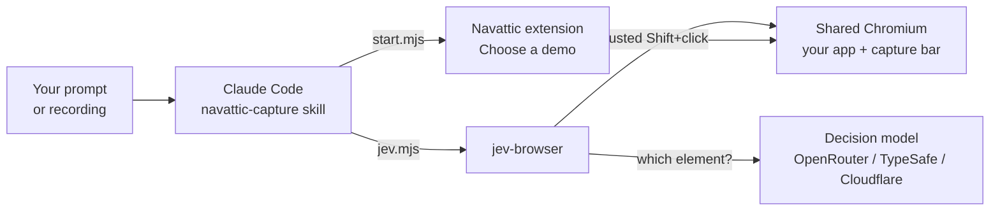

<div align="center">

# navattic-capture

**Fast Navattic captures from plain-English steps or a screen recording.**

A Claude Code plugin that drives a real browser with the Navattic extension and takes one capture per step. A small decision model picks each element, so Claude never reads the page: about 3× faster than Claude picking elements itself. You build the demo from the captures in Navattic, as usual.


[Quick start](#quick-start) · [Writing prompts](#writing-prompts) · [Screen recordings](#from-a-screen-recording) · [Configuration](#configuration) · [Troubleshooting](#troubleshooting)

</div>

---

## Contents

- [Why](#why)
- [Speed](#speed)
- [How it works](#how-it-works)
- [Requirements](#requirements)
- [Quick start](#quick-start)
- [Writing prompts](#writing-prompts)
- [From a screen recording](#from-a-screen-recording)
- [Configuration](#configuration)
- [Command reference](#command-reference)
- [Where things live](#where-things-live)
- [Troubleshooting](#troubleshooting)
- [Development](#development)
- [Credits](#credits)

## Why

Taking Navattic captures by hand means Shift+clicking through every screen, and starting over after each slip. This plugin does the clicking for you:

- **Prompt-driven.** Every choice goes in the prompt: a new or existing demo, whether to build it at the end, and which Copilot content to generate. Nothing needs editing between runs.
- **Fast.** A small decision model finds each element on the page, so Claude doesn't read the whole page at every step. See [Speed](#speed).
- **Recordings in.** Record the flow once with Cmd+Shift+5. Gemini (or Claude) turns the recording into written steps, and the plugin runs them.
- **Clean captures.** Each field is captured while it's still empty, then typed into, so the demo shows the empty field before the typed text. A "Saved" toast is still on screen when the last capture is taken.

## Speed

All runs below used the same 6-step flow (avatar → Admin Dashboard → a settings page → check "Videos" → Save), on the same app, with Claude Haiku and 7 captures. Measured from Claude Code transcripts, 2026-10-28.

| Who picks each element | Driver | Time | Tool calls | Page snapshots read |
| --- | --- | --- | --- | --- |
| Claude, reading page snapshots | MCP tools | 1:58 – 3:16 (median **2:27**, 4 runs) | 43–62 | 9–13 |
| OpenRouter pplx-decider | MCP tools | 1:19 | 40 | 6 |
| OpenRouter pplx-decider | `jev.mjs`, one call per step | 1:11 | 11 | 0 |
| **TypeSafe Jev** | **`jev.mjs`, steps chained (what ships)** | **0:45** | **5** | **0** |

Where the time goes:

- **Without a decision model,** Claude reads a 50–90 KB page snapshot to find each element. Each read costs a model turn and thousands of tokens.
- **With one,** the decision model answers "which element is the avatar button in the top right?" directly. `jev.mjs` then clicks it in the same call, and consecutive steps run as a single command.

> [!NOTE]
> The decision-model runs also used newer tooling, so the gap combines the two. The runs where Claude picked elements came before `jev.mjs` existed.

On a longer 12-step flow (create a course: typing, a dropdown, a checkbox, 15 captures), the decision-model backends compared like this:

| Backend | Time | Notes |
| --- | --- | --- |
| TypeSafe Jev | 1:13 | Every locate passed |
| OpenRouter liquid/d1.1 | 1:14 | One stale element, retried |
| OpenRouter liquid/d1-ultra | 1:24 | One unnamed field fell back to `find` |
| Cloudflare clef-flash | 3:01 | Low confidence scores; 3 fallbacks |

Recommendation: `DECIDER=typesafe` (Jev).

## How it works



1. `browser.sh` runs one Chromium with the Navattic extension loaded. Its profile keeps you logged in, and every tool attaches to it over Chrome's debugging port.
2. `start.mjs` opens your app and presses the Navattic button. It answers the **Choose a demo** dialog (a new demo, or an existing one) and waits until the capture bar shows 0 captures.
3. For each step, `jev.mjs` has the decision model find the element you described, then Shift+clicks it. In Navattic, that click is the capture.
4. `jev.mjs finish` presses **Finish**. Then it either closes the **Select your captures** dialog, which keeps the captures, or presses **Build demo**, with or without Copilot.

> [!NOTE]
> Navattic only takes a capture on a *trusted* click, one that comes from a real input device rather than from page JavaScript, which Navattic ignores. That's why this drives a real browser instead of scripting the page.

## Requirements

| | |
| --- | --- |
| **Claude Code** | Recent version with plugin support |
| **Node.js** | 22.15 or newer, plus `git`, `python3`, `curl` |
| **Navattic** | An account. Free accounts can only add to an existing demo |
| **Decision model** | A key for one backend: [OpenRouter](https://openrouter.ai/keys), [TypeSafe](https://console.typesafe.ai/keys), Cloudflare Workers AI, or your own endpoint |
| **Gemini** *(optional)* | An [API key](https://aistudio.google.com/apikey), for screen recordings |
| **ffmpeg** *(optional)* | Only for the legacy `replay.mjs` |

## Quick start

1. **Install the plugin.** In Claude Code, run:

   ```text
   /plugin marketplace add percusser/navattic-capture
   /plugin install navattic-capture@navattic-capture
   ```

   Then start a new session.

2. **Ask for a capture.** The first run runs `setup.sh`, which downloads jev-browser, its Chromium and the Navattic extension into `~/navattic-capture`.

   ```text
   Use the navattic-capture skill to capture a demo of https://app.example.com

   Steps:
   1. In the left navigation, click "Reports".
   2. Click "New report".
   ```

3. **Add your key.** Open `~/navattic-capture/.env` and fill in the key for the backend in `DECIDER=` (OpenRouter by default).

4. **Log in, once.** In the browser window that opened:
   1. Log into Navattic, then into your app.
   2. When Navattic shows **Site access required**, click **Enable site access**, then **Allow**.

5. **Tell Claude to continue.** It runs the steps and reports each one, with the expected and actual capture count.

Your logins stay in `~/navattic-capture/profile`, so steps 3 and 4 happen only once.

## Writing prompts

Write the steps the way you'd brief a colleague: one action per line, with each element's visible label in quotes and where it sits on the screen.

```text
Use the navattic-capture skill to capture a demo of https://app.example.com/courses
Add it to the "Course Builder" demo, and build it with Copilot for Sales.

Steps:
1. Click the "Create course" button in the top right.
2. Type "Onboarding 101" into the "Course name" field.
3. Open the "Category" dropdown and pick "Sales".
4. Check "Include videos".
5. Click "Save".
```

### Options you can put in a prompt

| Say | What happens | If you say nothing |
| --- | --- | --- |
| "call the demo Onboarding" | Creates a new demo named Onboarding | Creates a new demo named after the app's host and the time |
| "add it to the Sales Tour demo" | Adds the captures to an existing demo | |
| "build the demo" | Presses **Build demo** at the end | Closes the dialog. Captures are kept; nothing is built |
| "build it with Copilot for Sales" | Builds with Copilot content for Sales, Customer Success, Marketing, Product, or a custom option | |
| "build it without Copilot" | Builds with Copilot turned off | |
| "don't wait for toasts" | Takes the last capture as soon as the page settles | Waits a second so a toast such as "Saved" appears in the last capture |

### What counts as a capture

| Step | Captures |
| --- | --- |
| Click | 1 (Shift+click) |
| Typing into a field | 1, taken while the field is still empty |
| Dropdown choice | 2: opening it, then the option |
| Final screen | 1 (Control+c) |

The expected total is your steps plus one. The final report compares that total with what Navattic counted, which catches a missed or duplicated capture.

## From a screen recording

1. Record the flow with **Cmd+Shift+5**. Pause briefly on each screen.
2. Add `GEMINI_API_KEY` to `~/navattic-capture/.env`.
3. Prompt:

   ```text
   Use the navattic-capture skill to capture a demo from ~/Desktop/flow.mov.
   The app is at https://app.example.com. Call the demo "Flow walkthrough".
   ```

Gemini watches the recording and writes out numbered steps (`video2prompt.mjs`), and the skill runs them like a written prompt. The generated prompt is also saved to `~/navattic-capture/runs/<video name>/prompt.txt`, so you can rerun or edit it.

> [!TIP]
> Without a Gemini key, Claude can read stills from the recording itself. It's slower, but gives the same result.

## Configuration

All settings live in `~/navattic-capture/.env`, which `setup.sh` creates from [`.env.example`](plugins/navattic-capture/.env.example). Variables set in your shell override the file.

### Decision model

| `DECIDER=` | Needs | Model setting |
| --- | --- | --- |
| `openrouter` *(default)* | `DECIDER_OPENROUTER_KEY` | `OPENROUTER_MODEL`, e.g. `perplexity/pplx-decider-v1.2`, `typesafe/jev-1.13` |
| `typesafe` | `TYPESAFE_API_KEY` | `TYPESAFE_MODEL` (default `jev-latest`) |
| `cloudflare` | `CLOUDFLARE_API_TOKEN`, `CLOUDFLARE_ACCOUNT_ID` | `CLOUDFLARE_MODEL`: `clef-flash` or `clef` |
| `custom` | `CUSTOM_URL`, optional `CUSTOM_API_KEY` | `CUSTOM_MODEL` |

`DECIDER_MODEL` overrides the model of whichever backend is active. After switching, run `/mcp` in Claude Code and reconnect `jev-browser`.

To see what your `.env` resolves to, and which keys are missing, ask Claude to run `decider.mjs`.

### Other settings

| Variable | Default | Purpose |
| --- | --- | --- |
| `GEMINI_API_KEY` / `GEMINI_MODEL` | `gemini-3.5-flash` | Screen recording → steps |
| `CDP_PORT` | `9222` | The shared browser's debugging port |
| `NAVATTIC_HOME` | `~/navattic-capture` | Data folder. Set it in the shell, not in `.env` |
| `JEV_DIR`, `NAVATTIC_EXT`, `NAVATTIC_PROFILE` | inside the data folder | Use an existing jev-browser checkout, extension, or profile |

## Command reference

Claude runs these for you. They're listed here for debugging, or for running a step by hand. Paths are relative to the plugin folder.

| Command | Does |
| --- | --- |
| `bash setup.sh [--update-extension]` | One-time install. Safe to rerun; `--update-extension` fetches the latest Navattic extension |
| `bash browser.sh [--background] [URL]` | Starts the shared browser. Does nothing if it's already running |
| `node start.mjs <url> [--new "<name>" \| --existing "<name>"]` | Starts a capture session, ending with the capture bar at 0 |
| `node jev.mjs tab <url part>` | Selects the tab that shows the capture bar |
| `node jev.mjs shift "<description>"` | Finds an element and Shift+clicks it (a capture) |
| `node jev.mjs type "<field>" "<text>" [--submit]` | Captures the empty field, then types into it |
| `node jev.mjs capture` | Captures the current screen (Control+c) |
| `node jev.mjs settle` / `wait <s>` | Waits for the page to stop changing / waits a fixed time |
| `node jev.mjs finish [--build [--copilot "<option>" \| --no-copilot]]` | Presses Finish, then closes the dialog or builds |
| `node jev.mjs find "<name>"` | Lists matching elements with refs, for when a description doesn't match |
| `node video2prompt.mjs <video> [--url <start>]` | Turns a recording into a capture prompt |

`start.mjs` ends with a `RESULT {json}` line and an exit code: 0 for success, 2 when you need to act, 1 for an error. Exit 2 comes with a status:

| Status | Meaning |
| --- | --- |
| `needs_login` | Navattic wants you to log in |
| `needs_site_access` | Navattic needs site access for your app |
| `demo_limit` | The account can't create another demo; add to an existing one |
| `setup_failed` | The **Choose a demo** dialog went differently than expected |

## Where things live

```text
~/.claude/plugins/…/navattic-capture/   code: replaced on every plugin update
~/navattic-capture/                     your data: kept across updates and uninstalls
  .env                                  keys and settings
  profile/                              browser profile (your logins)
  extension/                            Navattic extension, pinned to its Web Store ID
  jev-browser/                          jev-browser and its Chromium
  runs/                                 recording stills and generated prompts
```

> [!WARNING]
> While the shared browser is running, any program on your machine can control it through its debugging port. Quit it when you're done.

To uninstall, run `/plugin uninstall navattic-capture@navattic-capture`, then delete `~/navattic-capture`.

## Troubleshooting

<details>
<summary><b>"Site access required" or a Navattic login page appears</b></summary>

`start.mjs` stops with `needs_site_access` or `needs_login`. Do it in the browser window, then tell Claude to continue. Both are saved in the profile.
</details>

<details>
<summary><b>"Demo limit reached"</b></summary>

Free Navattic accounts can't create more demos. Name an existing one in the prompt: "add it to the Sales Tour demo".
</details>

<details>
<summary><b>A step fails with <code>SEMANTIC_INCONCLUSIVE</code></b></summary>

The decision model wasn't confident enough about which element you meant. Claude falls back to `find` and clicks the element itself, and says so in the report. If it happens often, name the element by its exact visible label and say where it sits on the screen.
</details>

<details>
<summary><b>The capture count is off by one</b></summary>

- **Lower than expected:** a click landed before the capture bar was ready.
- **Higher than expected:** a capture was repeated.

The report names the step in either case. Open the demo in Navattic and delete or retake that capture.
</details>

<details>
<summary><b>The browser won't start</b></summary>

Check `~/navattic-capture/browser.log`. Another process may be using port 9222 (set `CDP_PORT`), or setup didn't finish (rerun `setup.sh`).
</details>

<details>
<summary><b>Navattic changed its UI</b></summary>

The skill's dialog handling lives in `skills/navattic-capture/SKILL.md` and `DIALOG.md`. `start.mjs` reports `setup_failed` with the text it saw, and the skill completes the dialog by hand.
</details>

## Development

This repo is generated. Edit the sources in `~/navattic-capture`, then rebuild:

```bash
node pack.mjs          # writes ./share: marketplace.json + plugins/navattic-capture
cd share && git commit -am "…" && git push
```

`pack.mjs` copies the scripts and the skill, and rewrites the skill's script paths to `${CLAUDE_PLUGIN_ROOT}`. It never copies `.env`, `profile/`, `extension/` or `jev-browser/`. To test locally without installing, run `claude --plugin-dir ./share/plugins/navattic-capture`.

The plugin has no `version`, so every pushed commit is an update for anyone who installed it.

## Credits

- [jev-browser](https://github.com/tontoko/jev-browser) by tontoko (Apache-2.0): browser automation and the decision-model tools. Downloaded at setup, not bundled.
- [Navattic](https://www.navattic.com): the capture extension, downloaded from the Chrome Web Store at setup. Not affiliated.
